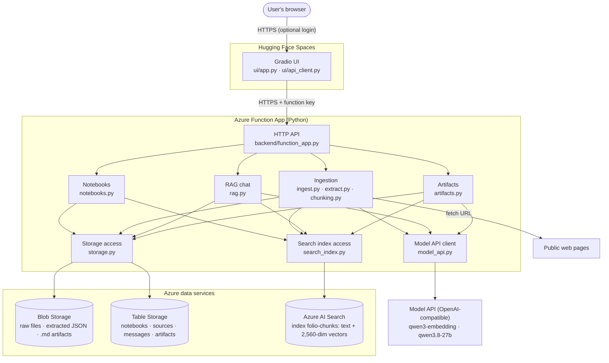
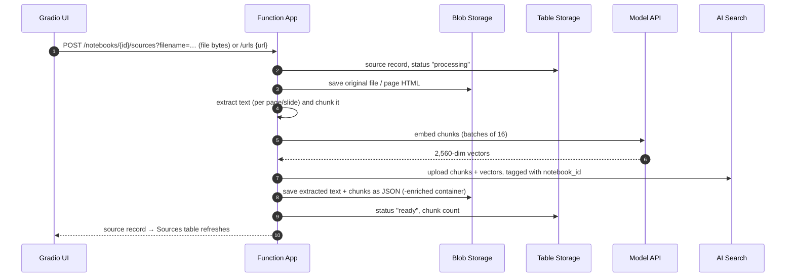
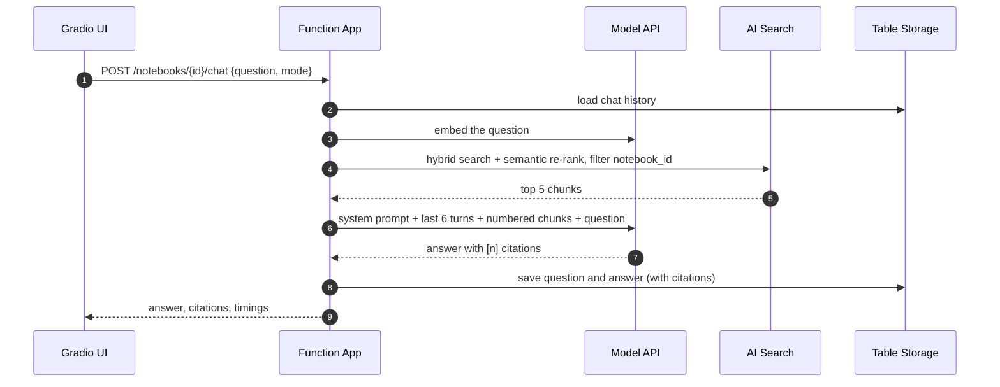
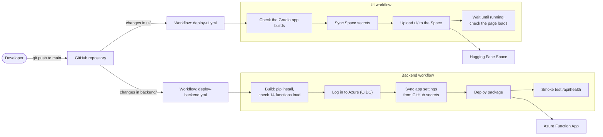

# Folio AI Architecture

Folio AI is a NotebookLM-style study app: users create notebooks, add PDF, PPTX, TXT, and web sources, ask questions
answered with citations (retrieval-augmented generation), and generate reports and quizzes. It has two deployable
parts, connected over HTTPS:

- **UI:** a Gradio app on Hugging Face Spaces. It holds no data and no model or Azure keys.
- **Backend:** a Python Azure Function App that does all the work. It stores data in Azure Storage and Azure AI Search
  and calls an OpenAI-compatible model API for embeddings and chat.

## Architecture diagram

## Major modules

| Module | Responsibility |
|---|---|
| `ui/app.py` | Gradio interface: notebook panel (create, rename, delete, switch), Sources, Chat, and Artifacts tabs, error messages |
| `ui/api_client.py` | Calls the backend API with the function key and turns API errors into user-facing messages |
| `backend/function_app.py` | 14 HTTP routes under `/api` (notebooks, sources, URLs, chat, messages, artifacts, health); maps errors to JSON responses with the right status code |
| `folio/config.py` | Reads settings from environment variables (the repo-root `.env` locally) and validates them |
| `folio/context.py` | Creates the storage, search, and settings clients once per process, and creates missing containers, tables, and the index |
| `folio/notebooks.py` | Notebook create, rename, and delete; deleting removes the notebook's blobs, index chunks, and table rows |
| `folio/ingest.py` | Ingestion pipeline for files and URLs; records each source's status (`processing` → `ready` or `failed`) |
| `folio/extract.py` | Text extraction: pypdf (per page), python-pptx (per slide, including tables and speaker notes), plain text, and web pages via BeautifulSoup, with a guard against private/internal addresses |
| `folio/chunking.py` | Recursive character chunking (paragraph → line → sentence → word), 1,200 characters with 200 overlap, keeping page/slide numbers |
| `folio/model_api.py` | Chat and embedding calls with retries and backoff; checks embedding dimensions |
| `folio/search_index.py` | Index schema, uploads, deletes, and the four retrieval modes |
| `folio/rag.py` | Question answering with numbered sources and `[n]` citations |
| `folio/artifacts.py` | Report and quiz generation |
| `folio/storage.py` | Blob and Table storage access, ID validation |
| `eval/run_eval.py` | Retrieval comparison used for [the evaluation](../eval/EVALUATION.md) |

## Data flow

### Adding a source

The whole pipeline runs inside the upload request; the UI waits for it to finish.

If any step fails, the source is marked `failed` with the reason, any partially uploaded chunks are deleted from the
index, and the UI shows the error.

### Asking a question

## Notebook storage

Every notebook has a random 32-character ID, and everything that belongs to it is keyed by that ID, so data survives
restarts and redeploys of both apps. IDs are validated before they're used in paths, table keys, or search filters.

| Data | Where | Key / path |
|---|---|---|
| Notebooks | Table `folionotebooks` | partition `notebooks`, row = notebook ID |
| Sources (name, type, status, chunk count, error) | Table `foliosources` | partition = notebook ID, row = source ID |
| Chat history with citations | Table `foliomessages` | partition = notebook ID, row = timestamp (sorts chronologically) |
| Artifact records | Table `folioartifacts` | partition = notebook ID, row = artifact ID |
| Original files | Containers `pdf-documents`, `pptx-files`, `txt-files`, `web-scraped` | `<notebook>/<source>/<filename>` |
| Extracted text + chunks | The matching `*-enriched` containers | `<notebook>/<source>.json` |
| Reports and quizzes | Container `artifacts` | `<notebook>/<artifact>.md` |
| Chunk text + vectors | AI Search index `folio-chunks` | document `<source>-<chunk #>`, filterable `notebook_id` |

Index fields: `id`, `notebook_id`, `source_id`, `source_type`, `source_name`, `source_url`, `page`, `chunk_index`,
`content` (searchable, English analyzer), `content_vector` (HNSW). A semantic configuration ranks on `content` with
`source_name` as the title.

**Limitations:** scanned/image-only PDFs aren't OCR'd; pages that need JavaScript to render may extract little text;
ingestion runs inside the HTTP request, so very large files can hit the platform's ~230-second request limit.

## RAG pipeline

1. **Embed** the question with `qwen3-embedding` (skipped for keyword-only search).
2. **Retrieve** the top 5 chunks from the notebook only (`notebook_id` filter). Four modes are available, selectable in
   the Chat tab:
   - `keyword`: BM25 full-text search.
   - `vector`: nearest neighbours over the chunk vectors.
   - `hybrid`: keyword + vector merged with Reciprocal Rank Fusion (vector candidates widened to 25).
   - `hybrid_semantic` **(default)**: hybrid, then Azure's semantic ranker re-scores the results against the
     question. Chosen by [the evaluation](../eval/EVALUATION.md) for the best answer quality and citation accuracy.
3. **Generate** with `qwen3.8-27b`: the system prompt requires answering only from the numbered sources and citing
   each claim as `[n]`, and saying so when the sources don't contain the answer. The last 6 chat turns are included
   for follow-up questions.
4. **Cite**: the `[n]` markers are matched back to the retrieved chunks; the UI lists each cited source with its page
   or slide, a link for web pages, and a short snippet.
5. **Store** the question and answer (with citations) in the notebook's chat history.

## Artifact generation

1. Load the notebook's chunks from the index in document order.
2. Select chunks **round-robin across sources** until a 24,000-character budget is used, so every source is
   represented even when the notebook is larger than the LLM's context.
3. Prompt the LLM with a fixed structure:
   - **Report:** title, overview, key concepts, important details, summary, sources, with inline `[n]` citations.
   - **Quiz:** 3–30 questions (default 10), mostly multiple choice plus true/false and short answer, followed by an
     **answer key** with explanations and source numbers.

   Users can add optional instructions (for example "focus on chapter 3").
4. Save the Markdown to the `artifacts` container and a record in `folioartifacts`. The UI renders it and offers the
   `.md` file for download.

## Deployment architecture

| Part | Platform | Deployed by | Secrets |
|---|---|---|---|
| Backend | Azure Function App, Flex Consumption, Python 3.13 | `.github/workflows/deploy-backend.yml` | Storage, Search, and model API keys are GitHub Secrets, copied into the Function App's environment variables on every deploy. Azure login uses OpenID Connect with a user-assigned managed identity (Website Contributor on the Function App), so no Azure password is stored. |
| UI | Hugging Face Space (Gradio SDK, ZeroGPU hardware, Python 3.12) | `.github/workflows/deploy-ui.yml` + `.github/scripts/deploy_space.py` | `HF_TOKEN`, the backend function key, and the optional UI login are GitHub Secrets; the backend URL, key, and login are copied into the Space's secrets on every deploy. |

Both workflows only run when their part of the repository changes, and each ends with a live check (the backend's
`/api/health`, the Space's page), so a broken deployment fails the run. No keys are committed; `.env` and
`local.settings.json` are gitignored.

**Hosting notes:**
- The Space runs on ZeroGPU because free CPU hardware wasn't offered. The UI does no GPU work; it registers one
  placeholder `@spaces.GPU` function (never called) because ZeroGPU requires one, and disables Gradio's server-side
  rendering, which crashed on Spaces.
- Free Spaces sleep when idle and take a short time to wake. No data is lost, because the UI stores nothing itself.
- The semantic ranker's free plan allows 1,000 semantic queries per month; heavier use needs the paid plan, or
  switching `RETRIEVAL_MODE` to `hybrid`.
